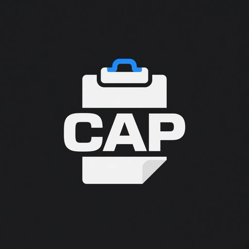

<div align="center">



# CAP

**Copy And Paste** — clipboard manager open source per la menu bar di macOS.

Cronologia degli appunti, gruppi personalizzati e incolla rapido nell'app che stavi usando.

[](#requisiti)
[](https://swift.org)
[](https://developer.apple.com/xcode/)
[](docs/ROADMAP.md)
[](#contribuire)

[Funzionalità](#funzionalità) · [Installazione](#installazione) · [Uso](#uso) · [Sviluppo](#sviluppo) · [Roadmap](docs/ROADMAP.md) · [Contribuire](#contribuire)

</div>

---

## Funzionalità

- 📋 **Cronologia appunti** — tutto ciò che copi viene salvato in locale (SQLite)
- 🗂️ **Gruppi personalizzati** — organizza i clip con nome e colore, accessibili con **⌘1 … ⌘9**
- ⚡ **Incolla rapido** — un click o **Invio** e il contenuto viene incollato nell'app precedente
- 🪟 **Pannello flottante** — **⌘⇧V** apre CAP vicino al cursore, ovunque tu sia
- 🔍 **Ricerca** e preferiti nella cronologia generale
- 🚀 **Avvio al login** e limite di cronologia configurabile
- 🔒 **Privacy first** — nessun cloud, nessun tracking: i dati restano sul tuo Mac

## Requisiti

| | Versione minima |
|---|---|
| macOS | 14 (Sonoma) |
| Xcode | 15 (solo per compilare) |

## Installazione

### Download (consigliato)

1. Scarica l'ultimo **`CAP-x.y.z.dmg`** dalle [Releases](https://github.com/brokenicedev/cap/releases/latest)
2. Apri il DMG e trascina **CAP** in **Applicazioni**
3. Avvia CAP: l'icona compare nella menu bar

L'app è firmata e notarizzata da Apple. Gli **aggiornamenti** arrivano direttamente nell'app (via [Sparkle](https://sparkle-project.org)): controllo automatico in background, oppure **click destro sull'icona → Controlla aggiornamenti…**

### Da sorgente

```bash
git clone https://github.com/brokenicedev/cap.git
cd cap
./release.sh
```

`release.sh` compila in **Release** e installa l'app in `/Applications/CAP.app`.

### Permessi

Al primo avvio concedi a CAP l'accesso in **Impostazioni di Sistema → Privacy e sicurezza → Accessibilità**: serve per simulare **⌘V** e incollare nell'app precedente.

> **Aggiornamento da build precedenti** (`com.francesco.CAP` o `com.francesco.CopyAndPaste`) — cronologia e preferenze vengono migrate automaticamente al primo avvio. Va però riattivato il toggle in **Accessibilità** per la nuova app (ed eventualmente **Avvio al login** nelle impostazioni).

## Uso

| Azione | Comando |
|---|---|
| Apri la cronologia | **Click sinistro** sull'icona nella menu bar |
| Impostazioni / Esci | **Click destro** sull'icona (oppure **⌘Q**) |
| Pannello flottante vicino al cursore | **⌘⇧V** |
| Incolla un elemento | **Click** o **Invio** |
| Passa a un gruppo | **⌘1 … ⌘9** |
| Torna a **Generale** | **⌘⇧,** (⌘<) — configurabile |
| Sposta tra Generale e gruppi | Menu contestuale sull'elemento |

**Generale** contiene tutto ciò che non è in un gruppo; **Cerca** e **Svuota** sono disponibili solo qui.
Da **Impostazioni** puoi creare gruppi (nome e colore), impostare il limite della cronologia, l'avvio al login e la chiusura del pannello dopo l'incolla.

## Sviluppo

```bash
./dev.sh
```

Chiude eventuali istanze in esecuzione, compila in **Debug** e avvia **CAP Debug** da `build/DerivedData/`.
In alternativa apri `CAP.xcodeproj` in Xcode e premi **Run**.

> La build Debug si chiama **CAP Debug** e ha una **barra gialla** sull'icona, così non la confondi con quella installata.

### Struttura del progetto

```text
cap/
├── CAP.xcodeproj
├── CAP/                 # sorgenti Swift
│   ├── App/
│   ├── Models/
│   ├── Services/
│   ├── Controllers/
│   ├── Views/
│   ├── Utilities/
│   └── Assets.xcassets, Info.plist, CAP.entitlements
├── Scripts/
│   ├── release-dmg.sh   # DMG firmato + notarizzato + appcast Sparkle
│   └── bump-version.sh  # versione / numero di build
├── docs/
├── appcast.xml          # feed aggiornamenti Sparkle
├── dev.sh               # build + run Debug
├── release.sh           # build Release + installazione locale in /Applications
└── build/, dist/        # output locale (gitignored)
```

| | |
|---|---|
| Bundle ID | `brokenice.it.cap` |
| Dati utente | `~/Library/Application Support/CAP/` |
| Architettura | [docs/ARCHITECTURE.md](docs/ARCHITECTURE.md) |
| Rilasci e aggiornamenti | [docs/RELEASING.md](docs/RELEASING.md) |

## Roadmap

Prossimi passi: incolla come solo testo, hotkey configurabili, export/import `.cap`, sync iCloud opzionale.
Dettagli in [docs/ROADMAP.md](docs/ROADMAP.md).

## Contribuire

I contributi sono benvenuti! 🎉

1. Fai un fork del repository
2. Crea un branch: `git checkout -b feature/nome-feature`
3. Fai commit delle modifiche: `git commit -m "Aggiunge nome-feature"`
4. Push sul branch: `git push origin feature/nome-feature`
5. Apri una Pull Request

Per bug o idee apri una [issue](https://github.com/brokenicedev/cap/issues).

---

<div align="center">
<sub>Fatto con ❤️ per macOS</sub>
</div>
