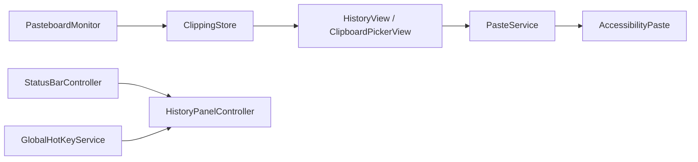

# CAP — struttura del progetto

**CAP** (*Copy And Paste*) è un’app macOS da menu bar: registra la cronologia degli appunti, organizza elementi in gruppi, incolla nell’app precedente (Accessibilità) e apre il pannello con click sull’icona o **⌘⇧V**.

## Identità

| Chiave | Valore |
|--------|--------|
| Nome app | CAP |
| Bundle ID | `com.francesco.CAP` |
| Legacy bundle | `com.francesco.CopyAndPaste` (preferenze migrate al primo avvio) |
| Application Support | `~/Library/Application Support/CAP/` |
| Legacy support dir | `CopyAndPaste/` (cronologia SQLite migrata se assente in CAP) |

## Cartelle (repository `CAP/`)

| Percorso | Contenuto |
|----------|-----------|
| `CAP.xcodeproj` | Progetto Xcode — target **CAP** → `CAP.app` |
| `CAP/App/` | Entry point (`CAPApp`), coordinamento, stato globale |
| `CAP/Models/` | Tipi di dominio, scope cronologia, preferenze utente |
| `CAP/Services/` | Pasteboard, store SQLite, hotkey, incolla, login al avvio |
| `CAP/Controllers/` | AppKit: menu bar, pannelli finestre, impostazioni |
| `CAP/Views/` | SwiftUI: cronologia, picker, impostazioni |
| `CAP/Utilities/` | Build debug/release, icone menu bar, metriche layout |
| `CAP/Assets.xcassets` | Icone app (release + debug con barra gialla) |
| `CAP/Info.plist`, `CAP/CAP.entitlements` | Bundle e sandbox |
| `Scripts/` | Tool da terminale (es. generazione icone debug) |
| `docs/` | Roadmap e note di progetto |
| `build/` | Solo output locale (`xcodebuild -derivedDataPath`); in `.gitignore` |

## Flusso runtime (semplificato)

`AppCoordinator` tiene riferimenti condivisi tra delegate, pannello e menu bar.
